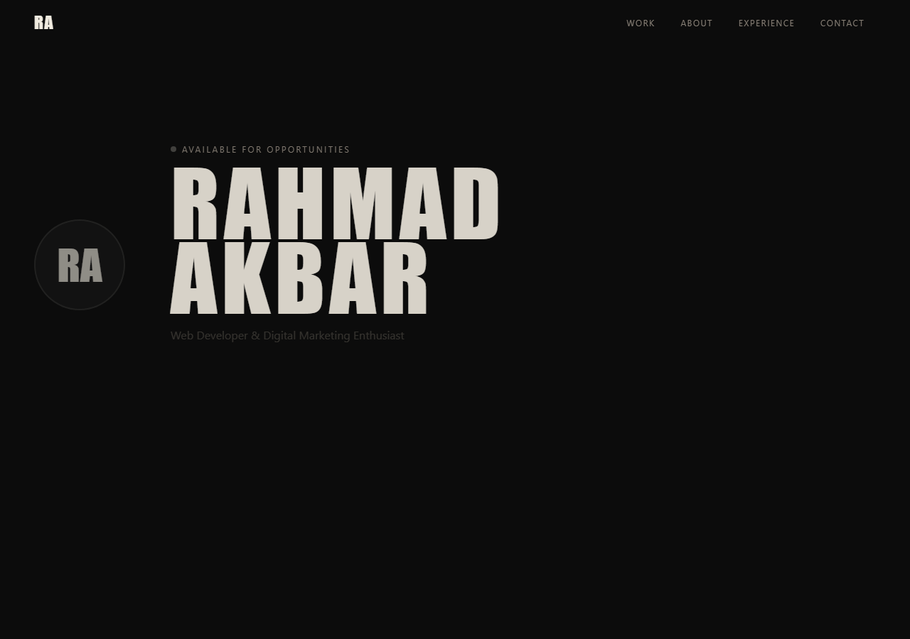

# Rachmad Akbar's Portfolio Website



A modern, premium, responsive personal portfolio website built with Next.js, TypeScript, Tailwind CSS, and Framer Motion.

## Features

- ✨ Minimalist, Apple-inspired design
- 🎨 Dark mode default with glassmorphism effects
- 🚀 Smooth animations and transitions using Framer Motion
- 📱 Fully responsive and mobile-optimized
- ⌨️ Command palette (Ctrl+K)
- 🎯 Scroll progress indicator
- ✨ Cursor glow effect
- 🎬 Animated gradients and floating blobs
- 📊 Animated statistics counters
- 🏆 Timeline components
- 📧 Contact form with validation
- 🌐 SEO optimized

## Tech Stack

- **Framework**: Next.js 14
- **Language**: TypeScript
- **Styling**: Tailwind CSS
- **Animations**: Framer Motion
- **Icons**: Lucide React
- **UI Components**: Custom React components

## Project Structure

```
F:\Portofolio\web/
├── app/
│   ├── globals.css
│   ├── layout.tsx
│   └── page.tsx
├── components/
│   ├── Navigation.tsx
│   ├── CursorGlow.tsx
│   ├── ScrollProgress.tsx
│   ├── CommandPalette.tsx
│   ├── Footer.tsx
│   └── sections/
│       ├── Hero.tsx
│       ├── About.tsx
│       ├── Statistics.tsx
│       ├── Skills.tsx
│       ├── Projects.tsx
│       ├── Experience.tsx
│       ├── Certificates.tsx
│       ├── Content.tsx
│       ├── Learning.tsx
│       ├── Testimonials.tsx
│       └── Contact.tsx
├── package.json
├── tsconfig.json
├── tailwind.config.ts
├── postcss.config.js
└── next.config.js
```

## Installation

```bash
npm install
```

## Development

```bash
npm run dev
```

Open [http://localhost:3000](http://localhost:3000) to view it in your browser.

## Build

```bash
npm run build
npm start
```

## Features Breakdown

### Navigation
- Fixed sticky navigation bar with responsive mobile menu
- Quick links to all sections

### Hero Section
- Large profile avatar with gradient
- Dynamic headline with role options
- Call-to-action buttons
- Animated background with floating blobs

### About Section
- Professional introduction
- Key strengths highlighted with checkmarks
- Two-column layout

### Statistics Section
- Animated counters
- Key metrics display
- Hover effects

### Skills Section
- Organized by category (Programming, Marketing, AI, Design, Soft Skills)
- Interactive skill tags
- Hover animations

### Projects Section
- Project cards with images
- Stack information
- View and GitHub links
- Hover animations

### Experience Section
- Timeline-style experience display
- Organization roles
- Descriptions

### Certificates Section
- Award icons
- Certificate information
- Issuer details

### Content Section
- Social media links
- Follower counts
- Platform-specific branding

### Learning Journey
- Timeline of milestones
- Personal growth journey
- Interactive timeline events

### Testimonials
- Star ratings
- Quote sections
- Author details

### Contact Section
- Contact information cards
- Contact form with validation
- Success feedback

### Command Palette
- Press Ctrl+K to open
- Quick actions
- Download CV
- Open social profiles

## Customization

### Colors
Edit colors in `tailwind.config.ts`:
```typescript
colors: {
  primary: '#2563EB',
  secondary: '#FFFFFF',
  accent: '#0F172A',
}
```

### Content
Update content in component files:
- `components/sections/Hero.tsx` - Hero content
- `components/sections/About.tsx` - About section
- `components/sections/Skills.tsx` - Skills list
- `components/sections/Projects.tsx` - Projects
- etc.

## Performance Optimizations

- Lazy loading with Framer Motion's `whileInView`
- Optimized images
- CSS-in-JS with Tailwind CSS
- Smooth scroll behavior
- Responsive design

## Browser Support

- Chrome (latest)
- Firefox (latest)
- Safari (latest)
- Edge (latest)

## License

MIT

## Author

Rachmad Akbar
